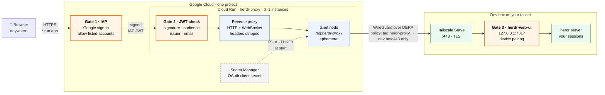

# herdr-web-gcp

Secure, phone-friendly browser access to [herdr-web-ui](https://github.com/devswha/herdr-web-ui)
running on a dev box that is only reachable on your Tailscale tailnet, with
nothing exposed on the dev box and no VPN client needed on the phone.

Three gates, in order:

1. **Google Identity-Aware Proxy (IAP)** on the Cloud Run service. Only the
   Google accounts you list may get past the sign-in page.
2. **The proxy's own IAP JWT check** (defence in depth): signature, audience,
   issuer and, by default, the same email allow-list.
3. **herdr-web-ui's device pairing.** The proxy is a tagged tailnet node, so
   Tailscale Serve adds no user login; the app asks each browser to pair once
   with a six-digit code generated on the dev box.

Nothing is stateful in the cloud. The herdr session lives on the dev box, and
the proxy's tailnet state is in `/tmp` and discarded with the instance. Cost is
effectively zero: scale-to-zero, one instance max, occasional use.

Design notes and the reasoning behind the choices: [`docs/design.md`](docs/design.md).
Infra details: [`infra/README.md`](infra/README.md).

## Layout

| Path | What |
|---|---|
| `src/herdr-iap-proxy/` | The Go proxy (one file), its tests, Dockerfile |
| `infra/service/` | Terraform: Cloud Run + IAP, runtime SA, secret, Artifact Registry |
| `infra/project/` | Terraform: optionally creates a dedicated GCP project |
| `tailscale/policy-snippet.hujson` | Policy change to merge into your tailnet policy |
| `deploy.sh` | Manual deployment driver (Infra Manager applies, image build, secret) |

## Prerequisites

- A Tailscale tailnet with the dev box on it, herdr-web-ui running there, and
  admin access to the tailnet policy file.
- A Google Cloud project with billing (or let `infra/project` create one), and
  an account with enough rights to create a service account and grant it roles.
- Locally: `gcloud`, `docker`, `git`, and ideally `jq`. Go is not needed; the
  image builds inside Docker.
- herdr-web-ui exposed on the dev box with Tailscale Serve:
  `tailscale serve --bg 7317` (adjust the port). Serve gives you a
  `https://<devbox>.<tailnet>.ts.net` URL with a valid certificate, which is
  what the proxy dials. The app itself keeps listening on localhost only.

## Setup, in order

Steps done in a web console rather than from the repo are marked **(H)**.

1. **Config.** `cp .env.example .env && chmod 600 .env`, fill it in. Copy
   `infra/service/terraform.auto.tfvars.example` to `terraform.auto.tfvars`
   and set `project_id`, `upstream` and `iap_members`.
2. **Deployer service account.** Infra Manager runs Terraform as a service
   account you create once. `infra/README.md` has the commands and roles.
3. **(Optional) Project.** If you want a dedicated project:
   `./deploy.sh preview project`, then `./deploy.sh project`. Put the resulting
   project ID into `infra/service/terraform.auto.tfvars` and `.env`.
4. **Phase 1.** `./deploy.sh base` enables APIs, provisions service agents, and
   creates the runtime SA, the empty secret and the Artifact Registry repo.
5. **(H) Tailnet policy.** Merge `tailscale/policy-snippet.hujson` into your
   policy file (tag owner, the `tag:herdr-proxy → dev box:443` grant, tests).
   Then: Settings → OAuth clients → Generate. Scope **Auth Keys: Write**, tag
   `tag:herdr-proxy`. Copy the secret once.
6. **Secret.** `./deploy.sh secret` and paste it. It is never echoed or stored
   locally; the proxy appends `?ephemeral=true&preauthorized=true` itself.
7. **Image.** `./deploy.sh image` builds in Docker, pushes to Artifact Registry
   and writes `infra/service/image.auto.tfvars` with the digest. Commit it.
8. **Phase 2.** `./deploy.sh apply`. Then `./deploy.sh url`.
9. **(H) Consumer accounts and organizations.** Skip this if the project is
   not in a Google Cloud organization, or if the IAP members are accounts of
   that organization. Otherwise (project in an org, you sign in with a
   `@gmail.com` account): Google-managed IAP OAuth clients only admit in-org
   users, and the org policy `iam.allowedPolicyMemberDomains` may block the
   binding. Once, in the Console for the project: **Google Auth Platform →
   Branding**, Audience **External**; then **Security → Identity-Aware Proxy →
   herdr-proxy → ⋮ Settings → Custom OAuth → Auto Generate Credentials →
   Save**. If step 8 failed on the `iap.httpsResourceAccessor` binding, re-run
   `./deploy.sh apply` now.
10. **(H) Pair the phone.** Open the service URL on the phone and sign in.
    herdr-web-ui shows its pairing screen. On a machine on the tailnet open the
    Serve URL → Settings → Phone & devices → generate a code → enter it on the
    phone. Once per browser.

## Acceptance checks

1. Incognito window → service URL → Google sign-in. A non-allowed account → 403 from IAP.
2. `curl -sI https://<url>/` with no credentials → IAP redirect/401, never the app.
3. Signed in: the UI loads, the terminal WebSocket connects, typing echoes,
   output streams without lag (`FlushInterval = -1`).
4. A command started in a herdr pane keeps running after the tab closes;
   reopening shows the same session.
5. After scale-to-zero, the first load succeeds within ~10 s (startup probe on
   `/healthz` holds traffic until tsnet is `Running`).
6. The Tailscale admin console shows one ephemeral `herdr-proxy` node while an
   instance is alive and none after it stops (the proxy logs out on SIGTERM).
7. The node can reach only the dev box on 443 (the policy `tests` encode this).
8. Requests with a missing or forged `X-Goog-Iap-Jwt-Assertion` get 401 from the
   proxy (`main_test.go` covers this; IAP itself stops them reaching the container).
9. No secrets in the repo, image or logs (`git grep tskey-`; the request log
   carries method/path/status/duration only).

Observed on a first deployment: the container listens about 3 s after start
and is on the tailnet about 4 s later; the first request after a cold start
takes about 4.5 s end to end; a raw WebSocket opens in well under a second
through the proxy; sessions of 15 minutes ran without drops; the instance got
SIGTERM after about 15 minutes idle, logged out, and the next boot registered a
fresh node with exactly one `herdr-proxy` peer on the tailnet.

## Operations

- **Rotate the Tailscale secret:** generate a new OAuth client (or secret),
  `./deploy.sh secret`, then force a new instance (`gcloud run services update
  herdr-proxy --region=<REGION> --project=<WORKLOAD_PROJECT> --update-labels=rotated=$(date +%s)`
  or just wait for scale-to-zero). Revoke the old client in the admin console.
- **New proxy build:** `./deploy.sh image`, commit `image.auto.tfvars`, `./deploy.sh apply`.
- **Change who may access:** edit `iap_members` (and `iap_allowed_emails` if
  you set it) in `infra/service/terraform.auto.tfvars`, `./deploy.sh apply`.
- **Logs:** `gcloud logging read 'resource.type="cloud_run_revision" AND resource.labels.service_name="herdr-proxy"' --project=<WORKLOAD_PROJECT> --limit=50`.
  JSON lines with `severity`; `component=tsnet` lines are Tailscale's user-facing messages.
- **Teardown:** `infra/README.md`.

## Troubleshooting

- **Pairing screen right after signing in, although the phone was paired.**
  The app's device cookie is `SameSite=Strict`; the first navigation back from
  accounts.google.com is cross-site, so the cookie is withheld once. Reload.
- **502 "upstream unavailable" on every request.** Check `/healthz` via the
  logs. If the tailnet is up, the usual cause is the policy: without the
  `tag:herdr-proxy → dev box:443` grant the peer is not in the netmap, so the
  MagicDNS name does not resolve. `upstream_dial_addr` (`"100.x.y.z:443"`) is
  the escape hatch if resolution itself is the problem.
- **Node missing / stale after idle.** The service runs with CPU always
  allocated (`cpu_always_allocated = true`) so tsnet keeps its control
  connection alive between requests. If that is ever switched off, expect the
  liveness probe to restart the container after an idle period; the cost of
  the default is cents, and only while an instance exists.
- **WebSocket upgrade rejected (403/400).** herdr-web-ui checks `Origin`;
  `rewrite_origin = true` (default) rewrites it to the Serve hostname.
- **"tsnet up failed" at start.** Bad or revoked OAuth secret, or
  `tag:herdr-proxy` not in `tagOwners`. The container exits 1 so it is visible.
- **"Connecting to herdr web ui…" for 40 s or more.** Not the proxy: the raw
  WebSocket opens in under a second (measure with `new WebSocket(...)` in the
  browser console), and the direct tailnet URL shows the same wait. It is the
  app's own boot and scales with load on the dev box.
- **"Input held until the terminal is ready" when typing into a pane.** herdr
  allows one attached client per terminal; another tab (often the direct
  tailnet one) already holds that pane. Use a pane no other tab has open, or
  discard the held input.
- **60-minute disconnects.** Cloud Run's request cap; the UI reconnects, the
  herdr session is unaffected.
- **"Setting IAM permissions failed" on the first IAP enable.** Service-agent
  timing in a fresh project; re-run `./deploy.sh apply`.

## Security notes

- The IAP JWT check in the proxy means that even if the Cloud Run service were
  somehow reachable without IAP, requests without a Google-signed assertion for
  this exact service are rejected before anything is forwarded.
- The proxy strips `X-Goog-*`, `X-Serverless-*`, `Tailscale-*`, `X-Forwarded-*`,
  `Forwarded` and `Authorization` before forwarding, so a browser cannot spoof
  identity headers towards herdr-web-ui.
- The Tailscale OAuth client is scoped to creating auth keys for one tag, and
  the policy restricts that tag to one destination and one port. Rotating it
  is a single `./deploy.sh secret`.
- The ephemeral node is logged out on shutdown, so no stale devices accumulate.
